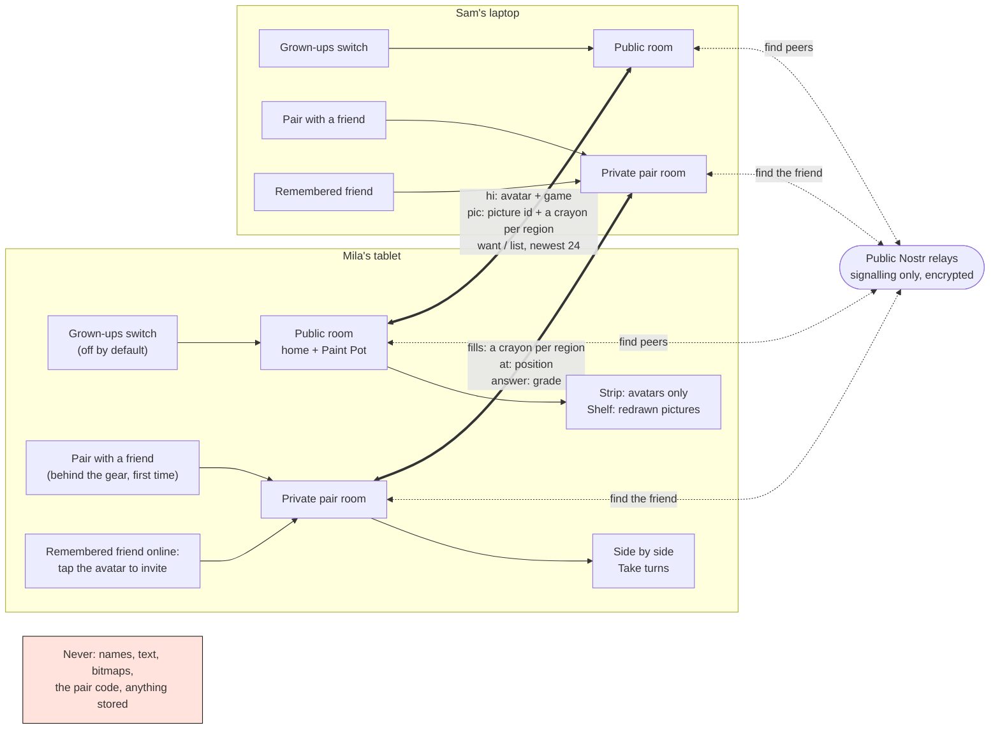

# Add presence and play-together: other children are here, and a friend can colour with you

## Context

Every game is played alone on one device, and the site has no server, no accounts and no tracking. The
owner wants two kinds of "together", both safe by construction: a warm, anonymous sense that other children
are playing right now (a strip of avatars, and in Paint Pot a shelf of pictures other children just finished),
and real play with one friend a grown-up chose. No chat, no names, nothing typed, ever.

This design is written against the redesign canvas (Little and Big modes, Pip the owl who says every prompt,
the "who is playing" picker, one sticker book, the Grown-ups area behind a three-second hold on the gear, one
calm voice). Where the canvas and today's code differ, the canvas wins. Everything here is additive: with the
switch off, which is the default, the app is exactly as it is now and loads nothing new.

The whole thing in one picture: two rooms, and what may cross the wire in each.



Reading it: the switch opens only the public room, where every message is an index into things the app
already knows. Pairing opens a second room that only the two devices with the same four-picture code can
derive, or two devices that were paired once before and remember each other. The relays only introduce
devices to each other; all messages go peer to peer.

## Design

- Devices talk to each other directly over WebRTC, with [Trystero](https://github.com/dmotz/trystero) 0.26
  (MIT) finding peers through public Nostr relays, so we run nothing
  - Trystero finds peers in a named room via the relays, opens data channels, and its typed actions
    (`makeAction`) carry small JSON messages peer to peer
  - It ships a dozen public Nostr relays with redundancy; BitTorrent trackers and MQTT brokers are one import
    away if Nostr ever goes quiet
  - The room config takes a password that encrypts the signalling, so relays only ever see ciphertext
    - For the public room the password is in the app's source, so this is against relay snooping only
  - Checked on 2026-10-24 with a throwaway route in the production build (`BASE_PATH=/gamesforkids`, served
    by `vite preview`): two tabs found each other through the relays within ten seconds
    - They exchanged an avatar message; one relay answered "rate-limited" and the others covered it
    - The Trystero chunk is about 27 kB gzipped, loaded by dynamic import only when the switch is on
  - What WebRTC exposes, said plainly: to connect directly, each browser tells the other its public IP address
    - An IP gives roughly the city and the internet provider, not a name or a street; local addresses are
      hidden behind mDNS names in current browsers
    - In the public room every device online learns the IP of every other, including anyone who opens the
      room with a script
    - That is the cost of running no server, and why the feature is off until a grown-up turns it on
    - Public rooms are small on purpose: the room id includes the language and a random shard of four, so a
      child shares a mesh with a handful of devices
  - Plan B if signalling proves flaky on school or home networks: a tiny Cloudflare Worker with one Durable
    Object per room, relaying the same JSON over WebSockets
    - About 80 lines, the free tier covers it, and nothing is peer to peer any more, so other devices never
      see an IP; only Cloudflare does. The message layer below is the same either way
- A grown-up turns it on, in Grown-ups, under Sound: "Play with others online", off by default
  - Off: nothing is imported and no relay is contacted. On: the public room is joined on the home screen and
    in Paint Pot
  - One honest note under it, in grown-up text: shows your child that other children are playing and lets
    them see pictures others finished
    - And the cost: devices connect directly, so other devices online can see this device's internet
      address. Nothing else is shared: no name, no photo, nothing typed
- Only things that cannot carry a child's words or drawings cross the wire
  - Presence is `hi {v, avatar, game}`: an index into the twelve drawn avatars of the "who is playing" picker,
    and a known game id or `home`
    - The peer id is Trystero's own `selfId`, random per page load, never persisted, never shown
    - The player's name never leaves the device: the strip shows avatars only
  - A gallery picture is `pic {v, id, picture, n, fills}`: a random id, a known picture id from
    `src/lib/paint.ts`, the sender's region count `n`, and one crayon index per region, -1 for unpainted
    - Never the bitmap: a brush scribble or a drawn word has no field to travel in. The receiver redraws the
      picture with the outline and its own flood fill
  - Every message passes one pure validator in a new module `src/lib/presence.ts`: version, exact field set,
    types, ranges, known ids, as many fills as regions, lists of at most 24
    - Anything else is dropped silently, with nothing a child could see
    - Rate limits per peer: one picture per ten seconds, one list reply, presence at most every two seconds;
      a peer over the limit is ignored for a minute
- Regions get stable indices from the outline, computed the same way on both ends
  - Draw the picture's path on an offscreen 800 px canvas at the game's own edge width, threshold the alpha
    at half, and label the 4-connected white components in row-major scan order
    - A component's index is the order its first pixel is met; its seed is the middle of that first run
    - Components under 400 px are anti-aliasing crumbs and are dropped
    - The pure part, `labelRegions`, takes a bit mask and returns the count and the seeds, so Node can test it
      without a canvas
  - Sender, on ✓: read the pixel at each seed from the painted canvas and map it to the crayon with that exact
    hex, else -1
  - Receiver: fresh canvas, outline, flood-fill each seed with its crayon, thick outline on top, as the
    finish step does today
  - Can go wrong: two browsers anti-alias a thin gap differently and count regions differently
    - Then the counts disagree and the picture is dropped, never drawn wrong. The pictures have big closed
      areas, so this should be rare
    - A test checks the count holds when the edge width moves by a pixel on a synthetic mask, and a
      browser-run script prints each picture's count so they can be pinned in the picture data if drift shows
- Pictures are ephemeral: nothing is stored anywhere
  - A device keeps the newest 24 pictures it received or sent, in memory, for the page's life
  - A joining device sends `want` to each peer; a peer answers once with `list`, its newest 24. When the last
    device holding a picture closes, it is gone
  - The child's own gallery is unchanged and stays in `localStorage`
  - IPFS or a pinning service would make pictures public, permanent, and need an account and a gateway.
    Everything we want from "someone else is painting too" is in the moment, so none of that fits
    - A lasting shared gallery, if ever wanted, is a moderated one on our own storage, not IPFS
- The strip shows avatars: no numbers, nothing to tap
  - Little home: a row of small drawn avatars (48 px, ink line, no keycap shadow, they are not buttons) under
    the top bar, starting beside the child's own player pill, which stays first and a little larger
    - Big home: the same row under the title. Paint Pot: on the chapter and picture screens, never while
      painting. Phone: the same row on one line
  - Alone, the row is just the child's own avatar; nothing says "nobody is here" and Pip says nothing
  - Someone arrives: their avatar fades in with the "tok" sound, once; nothing moves after that. Under reduced
    motion it simply appears
  - Each avatar wears a tiny badge of the game that child is in, the tile's own icon. At most six avatars, no
    count, no "12 playing"
  - A remembered friend's avatar wears the heart badge and comes first after the child's own; it is the one
    avatar that can be tapped, to invite (below). Every other avatar is not a button
  - The shelf of other children's pictures sits on Paint Pot's gallery screen under the child's own, redrawn
    at thumbnail size
    - Little: no heading, Pip says "Look what other children painted!" once when the shelf first fills. Big:
      a short label "Other children"
    - Tap one to see it big; no author, no star, no like, no reaction
- Playing together is only ever with one friend a grown-up paired, in a private room
  - "Pair with a friend", behind the gear on both devices, shows a code of four pictures drawn from sixteen
    of the existing sticker drawings (decided in review), big enough for a pre-reader to match
    - The other device's grown-up taps the same four. Both derive the pairing room id as a hash of the code
      and today's date, and use the code as that room's password
    - The code never travels: not as a message, and never through the public room, since pairing has a room
      of its own
    - Sixteen to the fourth is 65,536 codes, the pairing room is open ten minutes, and the first device
      confirms by tapping the avatar that appears
  - Once paired, the devices draw a fresh random room id, swap it inside the pairing room, leave it, and play
    there. The pair lives in memory and dies with the page
  - Pip says "Your friend is here!" and the friend's avatar joins the strip with a small heart badge. Still
    nothing to type and no name on either screen
  - Paired once, the two devices remember each other, so next time no code is needed (added in review)
    - On first use each device makes a random 128-bit friend key and stores it in `localStorage`; the two
      swap keys inside the pair room, and each keeps the other's key and avatar as a remembered friend
    - In the public room a device's presence carries, per friend, a daily tag: a hash of the friend key and
      the date. A friend recognises the tag; a stranger cannot invert it or forge it
    - The friend is online and the switch is on: their avatar shows on the strip with the heart. Tapping it
      makes Pip ask "Ask your friend to play?", then offers at most three mode pictures
    - The invite is `knock {tag, nonce}`; the friend's device checks the tag and Pip says "Your friend wants
      to play! Come?" with one big ▶. Both derive the private room from the friend key, the date and the nonce
    - A grown-up can forget a friend in Grown-ups; the friend key stays per device for now, not per player,
      since the "who is playing" picker is still on the canvas
    - Can go wrong: a child taps the heart avatar again and again. One knock per friend per minute; a knock
      the friend ignores just fades, with no sound on either side
  - Every mode is cooperative: `docs/learning.md` says children this age learn poorly from losing, so there is
    never a loser and never a score per child
    - Side by side (Paint Pot): the same picture, but each child paints their own copy, never one shared
      canvas (decided in review)
      - A live picture of the friend's copy sits in the corner, redrawn from the friend's region fills
        (`fills`, the gallery message's rule) every few seconds
      - The friend's crayon shows as a small avatar dot over it (`at {x, y}` normalised, ten a second,
        position only)
      - Bucket fills show in the friend's view; brush strokes stay on the child's own device, since a
        stroke is a bitmap and never travels. Pip explains nothing; the child just sees the friend's colours
        arrive
      - Each ✓ finishes that child's own picture, with praise and the sticker as today; Pip tells the other
        "Your friend finished!" and the finished copy shows in the corner until they finish too
      - The picture goes into the child's own gallery, and onto the public shelf when the switch is on
        (decided in review: both)
    - Take turns (Shape Sense, Number Dash): the pairing device picks a seed, both build the same question
      list from it, and turns alternate
      - The waiting child sees Pip say "Your friend's turn" beside the friend's avatar
      - The answering device sends `answer {i, grade}`; one shared row of five stars fills from both. "Almost!"
        is said only to the child who answered. Timers are off
    - Hexapawn against a friend is left out: it is solved, whoever moves second can always win, and one child
      loses every game. Chess Path's puzzles can be taken in turns like the other turn games
  - The friend leaves mid-picture: the avatar dims, Pip says "Your friend went away", and the child carries on
    alone; the corner view freezes, the picture stays and ✓ still gives the sticker
    - For two minutes the device keeps the room id and rejoins silently if the friend comes back; both send
      their current fills and the turn game its last answered index. After that, a new invite is needed
- Fits the rest of the app
  - New: `src/lib/presence.ts` (pure: message types, the validator, region labelling, the pair-code hash,
    the friend tag) and `src/lib/presence.svelte.ts` (the room: join, leave, send, state for strip and shelf)
    - The strip is its own component, `src/lib/PresenceStrip.svelte`; the switch and pairing go in the
      Grown-ups dialog
  - Every spoken line (the seven Pip lines above and the sixteen code-picture names) joins the voice catalog in
    `src/lib/i18n.ts` and is rendered in Pip's voice like every other line
  - Tests in `tests/presence.test.ts`, pure parts only
    - Region labelling on synthetic masks: two boxes give two regions in scan order, crumbs are dropped, the
      count holds when the edge grows by a pixel
    - The validator accepts each good message and rejects an unknown field, a wrong type, an avatar out of
      range, an unknown picture, too few fills, a list over 24
    - The pair-code room id is deterministic and never equals the public room id
    - The daily friend tag matches for the same key and date, differs for another key or the next day, and
      a knock with a wrong tag is rejected

## Alternatives

- A Cloudflare Worker relay from the start (plan B above): hides IPs, one place to rate-limit, but it is a
  server we run and a secret we hold, and the site stops being "static, nothing to operate". Kept as the
  fallback, and the first thing to reach for if the IP question weighs more than the no-server rule.
- Trystero over BitTorrent trackers or MQTT instead of Nostr: same code, different strategy import. Trackers
  are more often blocked on school networks; Nostr relays are plain WebSockets on 443. Nostr first.
  The only difference is who introduces the devices; once introduced, every path ends in the same direct
  WebRTC channel, except plan B, where the server stays in the middle:

  ```mermaid
  flowchart LR
    D1["Device A"] --> N["Nostr relays\nWebSocket on 443, dozens public,\nredundant: the default"]
    D1 --> T["BitTorrent trackers\nWebSocket, few support WebRTC,\noften blocked at school"]
    D1 --> M["MQTT brokers\nWebSocket, only a handful public,\nno redundancy built in"]
    N & T & M -. "introduce only" .-> C(["Direct WebRTC channel\nA ↔ B, peers see each other's IP"])
    D1 --> W["Plan B: Cloudflare Worker\nour own server, WebSocket"]
    W == "relays every message" ==> D2["Device B"]
    C --> D2
  ```
- SIP for signalling and STUN for discovery (asked in review): STUN is already in the design, since WebRTC
  uses it to learn a device's public address (Trystero points at Google's public STUN servers), but it does
  not find other devices; something still has to introduce them, which is what the relays do. SIP would do
  that job, but only with a SIP server we run (a registrar such as Kamailio or Asterisk, reached over
  WebSocket) and an identity per device, which is a bigger server than plan B's Worker for the same result.
  So: STUN yes, already there; SIP no. What neither gives is TURN: two devices both behind a strict NAT
  (some schools) cannot connect directly at all, and no public TURN exists for free. Plan B covers that
  case too, since nothing is direct.
- Sending the finished PNG (today's gallery format) instead of region colours: simplest, and exactly what we
  must not do, since a brush can write anything.
- A shared always-on room for play-together instead of pairing: a stranger could join. Pairing by a grown-up
  on both devices is the whole safety story, so no.
- Picking a random child who is online to play with (asked in review): left out for the same reason. Even
  without chat, a shared picture is a channel, and a stranger filling regions next to a four-year-old is
  not something a grown-up chose. Real friends first, remembered after one pairing; random play could be a
  later, opt-in step if it ever feels needed.
- One shared canvas for painting together (both children fill the same picture, last write wins): simpler
  state, but the owner prefers each child keeping a picture of their own while watching the friend's grow,
  so it is out.
- A competitive mode (first to finish, Hexapawn): left out, see the learning notes.

## Behaviour

- The switch is off: no import, no relay, no strip, no shelf, no pairing; Paint Pot is as today.
- Relays are unreachable (offline, blocked): the strip shows the child alone, exactly like nobody online.
  Pairing shows the code but no friend arrives; after ten minutes the grown-up sees "Could not find your
  friend. Try again on the same wifi." in grown-up text.
- A malformed or oversized message arrives: dropped by the validator; a peer over the rate limit is ignored
  for a minute.
- A received picture's region count differs from ours: dropped, never drawn wrong.
- The child changes player mid-session: the avatar in the presence message changes, the peer id does not; the
  shelf is kept.
- The page is closed or the tab sleeps: Trystero's leave runs on `pagehide`; peers see the avatar go.
- A device that is not a friend sends a knock, or guesses at one: no tag matches, so it is dropped and
  nothing shows on the child's screen. Only a grown-up pairing makes a friend; nothing a child does online
  can, and the tags strangers see change every day, so they cannot follow a device across days either.
- Two children pair while the public switch is off: pairing works on its own, since it is a separate room;
  the public strip stays hidden.

## Open Questions

- Does the IP exposure make plan B (the Worker relay) the better first version for you, even at the cost of
  running something? The design above is the no-server version; both share the message layer.
