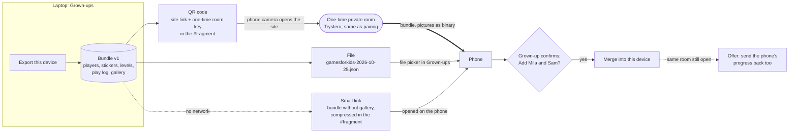

# Move a child's progress to another device: scan a QR code, or save a file

## Context

Everything a child has lives in one device's `localStorage`: players, each one's sticker book, levels per
game, the play log, settings, and Paint Pot's gallery. A family with a laptop and a phone has two separate
sets. The app has no accounts and no server, and promises none. Status: design, not built (October 2026).

The owner's requirements stand: a grown-up starts it, a QR code is the main hand-off, nothing passes through
a server or an account, taking progress in is a merge a grown-up confirms, and the gallery travels too. What
is new is the transport. The peer-to-peer channel being built for Paint Pot (`design/presence`) can carry a
whole profile, pictures included, so scanning a QR code on a phone opens the site there with exactly what the
computer has. A file covers the case where the devices are never online together. Later, the same export is
what gets persisted, so it is designed as one format from the start.

## Design

- One export format, a versioned bundle, used by every carrier
  - A new pure module `src/lib/transfer.ts` gathers and validates it: `{v: 1, made, players, stickers,
    levels, painted, language, plays, gallery}`, plus `settings` only when a grown-up asks for it
    - Levels are the per-game keys `storage.ts` already has (Letter Leap progress, Number Dash bests, Spell,
      Shape, Chess and Read Along levels), copied as they are
    - The gallery is the list of finished pictures as PNG data URLs, newest twelve, as stored today
  - The play log travels as the last month by default, or all of it, a choice on the send and save screens
    (decided in review). The device keeps at most 200 plays either way
  - Left out on purpose: the presence friend key and remembered friends. A friendship belongs to a device;
    copying it would make two devices answer as one
  - One validator for every way in: version, known keys, types, ranges, at most twelve pictures, each a PNG
    data URL under 200 kB. Anything else refuses the whole bundle, with a plain grown-up message
- Scan a QR code: the main way, live over the peer-to-peer channel
  - "Send to another device" in Grown-ups shows a QR code of the site link with a one-time room key in the
    fragment: `…/gamesforkids/#take=<room>.<key>`
    - A fragment never leaves the browser, so GitHub Pages never sees the key. The phone's own camera app
      reads the code and opens the browser: no scanner in the app
    - The key is 128 random bits; the room id and the Trystero room password are both derived from it, so
      the relays see neither the key nor the data
    - The QR library (`qrcode`, MIT) loads only in Grown-ups, by dynamic import
  - The phone opens the site, sees the fragment, removes it from the address bar, and joins the room
  - The laptop's grown-up approves the phone before anything is sent
    - When a device joins, both screens show the same two sticker pictures, picked from the key, and the
      laptop asks "Send to the device showing these?" with one Send button
    - Can go wrong: someone photographs the QR code across the room. They would also need the laptop's
      grown-up to tap Send on a match they cannot fake; the room closes after five minutes or one send
  - The bundle goes over the data channel, pictures as binary; Pip is not involved, this is grown-up work
  - Everything on the network is encrypted: the signalling with the room password, the bundle with WebRTC's
    own end-to-end encryption, so relays and any TURN server only ever carry ciphertext
    - The small link and the file are not encrypted: they travel by the grown-up's own hand (AirDrop, email,
      a folder), so whoever holds them can read them, and the screens say so
  - The phone then asks to merge (below). The room stays open a minute longer, so the phone can offer "Send
    this phone's progress back too?", which makes the two devices match after one scan
  - "Or the other way around" needs nothing extra: whichever device shows the code is the one sending
  - Can go wrong: both devices behind a strict network and no direct connection
    - A free TURN relay, if configured, carries the encrypted stream (see Alternatives); otherwise after
      twenty seconds the laptop offers the small link below
- A small link, for when the devices are never online together
  - The bundle without the gallery and with the last month of plays (at most 100), compressed (`CompressionStream`) and
    base64url-encoded into the fragment: `…/gamesforkids/#move=…`
    - Shown as a QR code when it fits (about 2 kB), always as a link to copy to AirDrop, a message or email
  - Opening it imports the same way as a live send; the pictures stay behind and the grown-up is told so
- Save a file, for parents
  - "Save to a file" downloads the full bundle as one JSON file, pictures included, named with the date
  - "Open a file" in Grown-ups takes it with the browser's file picker; same validator, same merge
  - The file is the honest full backup: it can sit in a parent's own folder or cloud drive, which is their
    choice and their account, not ours
- Taking progress in is a merge a grown-up confirms, never a replacement
  - Before anything changes: the incoming players' faces and names, "Add Mila and Sam to this device?"
  - A device with no players yet skips "who is playing" setup: after Yes it lands on the picker with the
    imported players, so a new phone starts exactly where the laptop is
  - Players match by id, which already travels with the player; a player not here is added
    - Stickers: union per player. Levels: the higher per game. Painted pictures: union. Gallery: union by
      content, newest twelve. Play log: union by game and start time
    - Language: kept from this device if it has players, taken from the bundle if it is new
  - Settings do not travel by default; each device keeps its own (decided in review)
    - "Also copy settings" is a checkbox on the send and save screens, off. When on, a new device takes them
      and a device with players asks before replacing its own
  - Can go wrong: the same child set up separately on both devices has two ids. The confirm screen shows a
    player whose name and age match one already here with "Same child?", and Yes merges the two
  - A stale or repeated import is harmless: every rule is a union or a maximum
- Later, not now: the bundle is the unit of persistence
  - Whatever keeps a family's progress safe later stores this bundle and nothing else
    - Candidates: a reminder to save a file, an automatic file in a folder the parent picked (Chrome's File
      System Access), or two of the family's own paired devices keeping each other in step when both are on
  - Two family devices stay in step with the same merge, over the presence design's remembered-device room
  - No server of ours holds it; if hosted storage ever comes, it stores an encrypted bundle it cannot read
- Fits the rest of the app
  - Grown-ups gets one box, "Move to another device", with Send to another device, Save to a file and Open a
    file. A child never sees any of it
  - Grown-up text only, both languages, no voice lines
  - Tests in `tests/transfer.test.ts`, pure parts only
    - A bundle survives export, validate and import unchanged; the validator refuses an unknown version, a
      wrong type, a thirteenth picture, a non-PNG data URL
    - Merge rules: stickers union, higher level wins, plays deduplicated, a repeated import changes nothing
    - The small link round-trips through compress and base64url, and leaves out the gallery
    - The room id, password and match pictures are the same on both sides for one key, and differ for another

## Alternatives

- A six-letter code typed by hand instead of a QR code: a grown-up could, but the camera does the same with
  less friction and carries a longer key.
- The small link as the only way: no network needed, but it cannot carry the pictures, and a full play log
  makes the QR code too dense to scan.
- A free relay (asked in review): yes, as a pass-through, never as a mailbox.
  - A free TURN relay, such as a public TURN service's free tier, is the right kind: it only forwards the
    WebRTC stream, which is end-to-end encrypted (DTLS) between the two devices, and stores nothing
    - It fixes the one case the design cannot handle today, two devices on strict networks; its terms and
      limits need checking before we rely on it, and its credentials sit in the app's source
  - A free mailbox (upload now, download later) is the wrong kind, even encrypted with the key from the QR:
    the bundle sits on someone else's server for a while, which breaks "nothing goes anywhere" (decided in
    review: pass-through relays only)
  - The Worker relay from the presence design is the pass-through kind too, so it stays acceptable as a
    fallback transport, never as storage
- Importing without confirmation: a stray link could change a device; rejected.

## Behaviour

- The phone opens a `#take` link after the room closed: "This code has expired. Make a new one on the other
  device." Nothing changes.
- The connection drops halfway: nothing is merged until the whole bundle arrives and validates.
- The phone's storage is full: the merge keeps the newest gallery pictures that fit, as saving a picture
  does today, and says how many stayed behind.
- A file from a newer version of the app: refused with "Update this page and try again"; an older version is
  read and upgraded.

